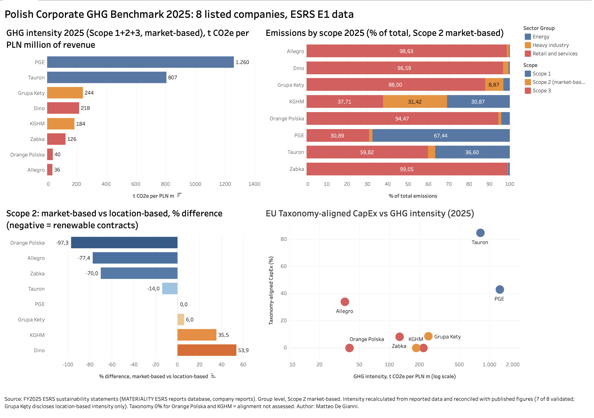

# Polish Corporate GHG Benchmark 2025 (ESRS E1)

Benchmark of greenhouse gas emissions, energy use and EU Taxonomy alignment for 8 companies listed on the Warsaw Stock Exchange, built from their first full-year ESRS sustainability statements (FY2025).

**Interactive dashboard:** [Tableau Public](https://public.tableau.com/app/profile/matteo.de.gianni/viz/PolishCorporateGHGBenchmark2025/Dashboard)



## Scope

| Company | Sector | Report used |
|---|---|---|
| PGE Polska Grupa Energetyczna | Energy utilities | Management Board report 2025 |
| Tauron Polska Energia | Energy utilities | Management Board report 2025 |
| KGHM Polska Miedź | Metals and mining | Management Board report 2025 |
| Grupa Kęty | Industrial manufacturing | Sustainability statement 2025 |
| Dino Polska | Food retail | Management Board report 2025 (ESEF) |
| Grupa Żabka | Food retail | Annual Report 2025 |
| Orange Polska | Telecommunications | Management Board report 2025 |
| Allegro.eu | E-commerce | Annual Consolidated Report 2025 |

Banks and insurers were excluded because financed emissions (Scope 3, category 15) are not comparable with operating companies. Reports were located through the MATERIALITY database of ESRS reports and company investor relations pages.

## Method

1. **Data collection.** For each company, values were extracted from disclosures E1-6 (Scope 1, 2 location-based and market-based, 3), E1-5 (energy), S1-6 (headcount) and the EU Taxonomy KPI tables, together with consolidated net revenue. Every value is linked to its page in the source report.
2. **Normalisation.** Values are entered in the unit used by the company and converted through a unit lookup table (tCO2e, PLN million, MWh).
3. **KPIs.** GHG intensity (Scope 1+2+3, market-based, per PLN million of revenue), Scope 3 share, Scope 1+2 per employee, energy intensity, Scope 2 market-based vs location-based gap, Taxonomy-aligned turnover, CapEx and OpEx.
4. **Validation.** The recalculated GHG intensity is compared with the intensity published by each company (tolerance 5%). Differences are investigated and documented in an issue log.
5. **Power Query.** The normalisation layer was rebuilt in Power Query (blank row removal, 3 merges with the unit table, 4 calculated columns) and reconciled with the formula-based model: 0 differences across the 8 companies.
6. **Visualisation.** Interactive dashboard in Tableau Public.

## Validation results

| Company | Recalculated intensity (t/PLN m) | Published | Status |
|---|---|---|---|
| PGE | 1,260.0 | 1,300 (published as 0.0013 t/PLN) | Validated within rounding |
| Tauron | 806.8 | 807 | Validated |
| Grupa Kęty | 244.0 (MB) | location-based only (242.7) | Review |
| Dino Polska | 217.7 | 217.7 | Validated |
| KGHM | 184.4 | 184.4 | Validated |
| Grupa Żabka | 125.9 | 125.9 | Validated |
| Orange Polska | 39.8 | 40 (published as 0.04 t/PLN thousand) | Validated |
| Allegro.eu | 35.8 | 35.1 | Validated, difference explained |

7 of 8 companies validated. Grupa Kęty publishes only the location-based intensity, although ESRS E1-6 requires both; its location-based value was recomputed manually (242.8 vs 242.7).

## Key findings

- **Intensity spans a factor of 35**, from 36 t CO2e per PLN million (Allegro) to 1,260 (PGE).
- **Utilities show the transition paradox.** PGE and Tauron have the highest emission intensity and also the highest Taxonomy-aligned CapEx (42.9% and 84.5%), driven by grids and renewables. Measuring only one side gives a misleading picture.
- **Scope 3 dominates outside heavy industry.** It is 94% to 99% of total emissions for retail, telecom and e-commerce, while Scope 1 is 67% of PGE's total. KGHM is the only company where all three scopes are material.
- **Market-based Scope 2 depends on contractual instruments.** It is 97% below location-based for Orange Polska (100% renewable electricity through PPAs and guarantees of origin), but 54% above for Dino, which buys no certificates and therefore applies the Polish residual mix factor (808 vs 525 tCO2/GWh). PGE applies the national average to both methods, so its market-based figure is not comparable.
- **Business models change what can be compared.** Żabka's franchised stores report their electricity in Scope 3 category 14, while Dino reports store energy in Scope 1 and 2. Between the two food retailers only total (Scope 1+2+3) intensity is comparable.
- **Boundaries matter for reconciliation.** Allegro's intensity matched only after adding back the revenue of Mall South (held for sale, reported as discontinued operations), which is still included in the emissions boundary.

## Data quality log

40 issues are documented in `issue_log.csv`, grouped by type: boundary or scope differences, restatements, unit inconsistencies, missing disclosures and unclear methodology. Examples:

- Allegro: emissions include Mall South while income statement revenue excludes it (5.8% intensity distortion if not corrected).
- PGE: the breakdown table labels the Group total as the parent company figure, and parent plus subsidiaries does not add up to the consolidated row.
- Orange Polska and Dino: Taxonomy turnover reported as 0% because alignment was not assessed under the materiality exemption (Delegated Regulation 2026/73), not because activities are non-aligned.
- Grupa Kęty: Scope 3 category 1 partly estimated with US EPA spend-based factors for a European supply chain.

## Repository structure

```
ESG_GHG_Benchmark_Poland_2025.xlsx   Full model: inputs, unit table, calculations, quality checks, Power Query output
Tableau_Data_ESG_Poland.xlsx         Clean data source for the Tableau dashboard
companies_summary.csv                One row per company with all KPIs
issue_log.csv                        Data quality issue log
dashboard.png                        Dashboard screenshot
```
## Limitations

- One reporting year only (FY2025, the first year for several companies), so no trends.
- Scope 3 figures rely heavily on spend-based estimates and are not comparable in precision across companies.
- Consolidation approaches differ (financial vs operational control).
- Revenue is used as the intensity denominator for all companies, which favours high-revenue, low-margin business models.

## Tools

Excel (structured tables, XLOOKUP, data validation), Power Query, Tableau Public.

## Author

Matteo De Gianni, MSc Data Science student at PJAIT, Warsaw
[LinkedIn](https://www.linkedin.com/in/matteo-de-gianni-910a52358) | [GitHub](https://github.com/matteodegianni)
